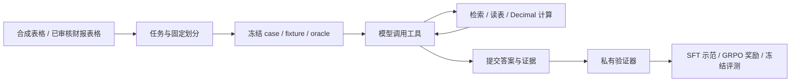

# FinFlow Agent

金融工具 Agent 的任务构建、SFT、GRPO 训练与评测入口。研究环境支持在冻结财报表格中检索、读表、计算和提交证据，复用 FinFlow 的治理资产与数据划分。

## 快速开始

准备合成任务、参考工具示范和训练配方：

```sh
python -m agent.cli rl-start --output data/agent/experiments/research-01
```

在训练机上衔接 SFT 与 GRPO：

```sh
python -m agent.cli rl-start --output data/agent/experiments/research-01 --train
```

默认模型为 `Qwen/Qwen3.5-0.8B`，配方采用单卡 BF16 LoRA。依赖安装、治理表格导入、checkpoint 恢复和评测命令见[RL 指南](trainers/rl/README.md)。

## 命令入口

| 命令 | 用途 | 文档 |
| --- | --- | --- |
| `import-assets` | 从 v7 证据包导入图片、来源和候选决定 | [治理资产](assets.md) |
| `inventory` / `verify-inventory` | 检查旧 OCR 输出的媒体映射与文件 | [OCR 资产诊断](inventory.md) |
| `sft` | 训练文本、视觉或工具轨迹 LoRA | [SFT 指南](trainers/sft/README.md) |
| `rl-build` | 构建合成财报计算任务 | [RL 指南](trainers/rl/README.md) |
| `rl-import` | 从已接受的表格转录构建研究任务 | [治理表格任务](trainers/rl/README.md#4-从已有治理结果接入真实财报表格) |
| `rl-sft` | 导出参考示范或回收成功 rollout | [工具示范](trainers/rl/README.md#3-可选先学会工具协议再做-rl) |
| `rl-start` | 准备实验并衔接 SFT、GRPO | [实验准备](trainers/rl/README.md) |
| `rl` | 启动多轮 GRPO | [RL 指南](trainers/rl/README.md) |
| `rl-eval` / `rl-report` | 冻结评测与训练诊断 | [评测与报告](trainers/rl/README.md#7-冻结评测) |

## 研究任务



| 工具 | 返回或操作 |
| --- | --- |
| `search_documents` | 按查询、公司与期间检索表格，支持分页 |
| `read_table` | 读取表头、行列、单位、口径和 cell ID，可按期间筛选 |
| `calculate` | 对已观察的单元格或计算引用执行 Decimal 运算 |
| `submit_answer` | 提交数值、单位、期间、口径及证据 |

验证器核对数值、小数位、实体、期间、口径与支持单元格。完成任务得 `1`，有效失败得 `0`，调用已知但未授权的工具得 `-1`。未知工具名和参数错误返回可恢复观察；基础设施故障记录为 `null` 奖励。

训练默认接受包含完整支持集合的额外已观察证据；冻结评测默认要求精确支持集合。具体原因代码和参数见[奖励规则](trainers/rl/README.md#5-奖励规则)。

## 数据与轨迹

| 对象 | 内容 |
| --- | --- |
| `task.json` | 问题、允许工具、任务预算与输出格式 |
| `fixture.json` | 环境宿主加载的文档和表格初态 |
| `oracle.json` | 私有参考计算与可接受证据集合 |
| `case.json` | 文件 hash、split、分组键、环境及奖励版本 |
| `episode.json` | 工具调用、观察、计算、结束原因与评分 |
| `tokens.jsonl` | 后端原生 token、logprobs 与 assistant loss mask |

模型通过 task 和工具观察获取材料，oracle 由验证器读取。SFT 使用执行通过的参考示范或重放通过的成功轨迹；GRPO 由当前策略在线生成同题多条轨迹。工具观察作为上下文，策略损失作用于 assistant 输出。

任务构建继承上游 work/content/image 的划分；同一来源的派生问题保留在同一个 split。运行目录保存冻结输入和版本清单，数据、轨迹与 checkpoint 位于 `data/agent/`。

## 模块

| 模块 | 职责 |
| --- | --- |
| `adapters/` | v7 治理资产与 OCR 媒体导入 |
| `datasets/` | 合成/治理表格任务、参考 SFT 与成功轨迹导出 |
| `environment/` | case 加载、工具执行与 episode 生命周期 |
| `verifiers/` | 参考计算、证据核对与终局奖励 |
| `pipeline.py` | 实验准备、SFT → GRPO 衔接及阶段恢复 |
| `trainers/` | 单卡 SFT、ms-swift 多轮插件与训练报告 |
| `evaluation/` | reference、replay、model 策略的冻结评测 |
| `schemas/`、`tools.json` | 任务、轨迹和工具接口契约 |

## 扩展设计

视觉工具与治理排障任务的接口设计见[多模态工具](multimodal.md)、[SFT 与 RL 数据设计](sft-and-rl.md)和[合成协议样例](examples/README.md)。运行环境与框架对接见[Agentic RL 架构](../docs/agentic-rl-review.md)。
