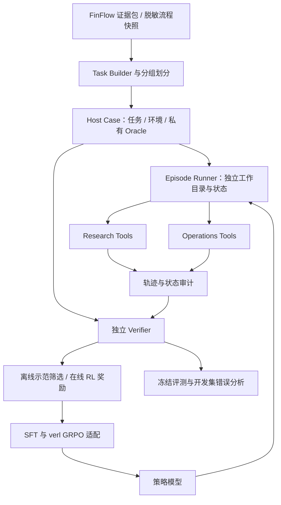

# FinFlow Agentic RL V0.1 设计

状态：2026-10-19 更新。已实现既有治理资产导入，以及可选的离线 OCR 图片摸底/报告校验；本目录还包含 V0.1 基础接口契约与合成样例，以及多模态扩展设计。已新增单卡普通文本/视觉SFT启动入口；Agent交互环境、视觉工具、Agent SFT/RL入口和实验结果仍待开发。样例轨迹均标记为 `design_example`，未执行、未评分、不可直接用于训练。

目录约定（2026-10-19）：`agent/` 是本项目 Agentic RL 的统一入口，集中保存财报取证、数据治理与故障排查的设计、契约、样例，以及后续环境、工具、验证器和训练适配实现。

模态范围已确认：文本、结构化表格、PDF 页面图像及 OCR 检测到的 image/chart/table/figure 区域。详见[多模态设计](multimodal.md)。现有 V0.1 机器契约和四个案例仍为文本/结构化协议，`read_table` 返回单元格 JSON；图像工具、媒体观察契约及训练适配按 V0.2 实施。FinFlow 已有的视觉资产与图文 SFT 代码可复用，真实模型流程仍待验收。

实施约定：直接复用 FinFlow 已有来源决定、候选审核、图片关联和血缘，设计明确后就写代码并按实际错误迭代。新增 Agent 功能不要求整批数据重新校准或人工校对；需要定位的具体 bad case 单独处理。

入口：[单卡SFT训练](trainers/sft/README.md)、[复用治理资产（可运行）](assets.md)、[OCR 图片摸底（可选诊断）](inventory.md)、[SFT 与 Agent RL 联合设计](sft-and-rl.md)、[多模态设计](multimodal.md)、[任务 schema](schemas/task.schema.json)、[轨迹 schema](schemas/trajectory.schema.json)、[工具表](tools.json)、[案例与谓词说明](examples/README.md)。

## 1. 目标与第一版范围

把 FinFlow 扩展为可训练、可重放、可评价的金融工具使用环境，覆盖两条任务线：

| 任务线 | Agent 的目标 | 验收结果 |
| --- | --- | --- |
| `research` 财报取证与核算 | 检索资料、读取表格、核对实体/期间/口径、计算并提交证据 | 数值与证据均正确 |
| `operations` 数据治理与故障排查 | 观察状态、追踪原因、执行允许的恢复、复验或转人工 | 修复、正确转交或正确确认无需操作 |

V0.1 同时建立两个环境和独立基线；共享工具/轨迹协议，分别实现验证器。先做单模型多轮交互，再比较单任务训练与混合训练。跨任务联动作为后续阶段。

首版环境为本地固定语料与独立 SQLite/文件快照，工具只处理该 episode 的范围。训练使用独立、显式启动的适配器。生产数据接入、模型训练和消息渠道连接各自显式配置。

两条任务线均加入视觉扩展：财报看图取数与图文核对；治理侧核查 OCR 漏负号/错列、裁剪不完整和图片完整性。先跑通基础协议，再扩展真实图像观察与多模态 SFT/RL。

## 2. 已有代码与新增边界

| 已有模块 | 可以复用 | 新增工作 |
| --- | --- | --- |
| `delivery/flywheel_release.py` | v7 证据与文件依赖闭包 | 转为可检索的环境快照、精确表格单元格标识 |
| `processing/visual_assets.py` / `visual_asset` | OCR 视觉 occurrence、可用图片、来源与坐标状态 | 页面/区域读取、坐标可验证的裁剪、媒体轨迹与视觉证据验收 |
| `storage/flywheel_store.py` | 持久任务、依赖、工件 DAG | episode 内的范围约束、状态检查和故障注入 |
| `integrations/service.py` | 权限检查、幂等 job、重试语义 | 有边界的状态/任务/策略查询和恢复工具 |
| `storage/flywheel_review.py` | 血缘读取与独立人工决定 | agent 只提交转交记录，人工审核继续独立执行 |
| `training/sft_recipes.py` | Decimal 算术和引文检查思路 | 取数语义验证、多步骤计算 DAG、延迟舍入 |
| `training/sft_export.py` | 包校验与媒体绑定思路 | 新的工具轨迹导出；现有角色序列不支持 tool 消息 |
| `training/sft_splits.py` | 同源分组与持久划分思路 | 增加任务模板、故障变体、环境快照分组 |
| `training/daily_release.py` | 不可变工件、校验和及阶段恢复 | 独立 agent 数据包与环境快照发布 |

当前 `FinFlowService.retry()` 会排入 job；执行 `retry_task` 后创建替代任务、把旧任务置为 superseded 并重接待执行依赖。**排队成功不能记为恢复成功**，必须运行限定任务并独立检查最终状态。

`DailyFlywheel.run()` 含全局扫描、backfill、发布和锁逻辑。episode 不直接调用整轮飞轮；新增有界 stage adapter，初期复用原队列/工件语义，在隔离目录执行指定处理器。处理器的本地确定性模式须明确标注，之后用真实 OCR/模型验收迁移能力。

## 3. 总体结构



同一任务可有多条有效路径。环境负责权限、执行和记录；验证器从私有 oracle 与实际最终状态评分。工具响应不暴露 oracle、故障注入标签、预期处置或评分分量。

## 4. 契约与可见性

| 文件/对象 | 消费者 | 内容 |
| --- | --- | --- |
| `task.json` | Agent | 问题、任务范围、允许工具、预算与输出契约 |
| `fixture.json` | 环境宿主 | 文档表格或流程初始状态；经过允许工具投影后返回 |
| `oracle.json` | Verifier | 参考计算、证据等价集合、最终状态谓词与允许处置 |
| `case.json` | 调度器 | 文件哈希、数据划分、分组键、环境与奖励版本 |
| `trajectory.json` | 审计/训练适配器 | 逐步调用、观察、策略身份、结束原因、独立评分 |

正式机器契约位于 `schemas/`，工具输入契约位于 `tools.json`。`case.json` 和 oracle 不进入模型输入，字段白名单投影应由服务端完成。公开合成样例中的 oracle 供设计审阅；真实训练中要在工具不可读取的位置保存。

### 4.1 Episode 生命周期

`created → ready → running → submitted/step_limit/generation_limit/forbidden_action/infrastructure_failure → verified → archived`。

每次工具调用计一个 action，包括参数错误；V0.1 一轮执行一个调用。参数错误返回可恢复观察，消耗预算。超预算、禁止动作终止 episode。合法的工具业务错误（如任务中的 OCR timeout）属于环境观察；宿主损坏、推理服务失联等基础设施故障单独中止，不混入有效策略失败。

`submit_answer` / `submit_resolution` 为终止动作；最终得分由提交后的独立验证器生成，工具本身不返回分数。未提交的自然语言回答不能替代终止动作。

建议初始预算：research 8 次调用、operations 12 次；单次模型输出上限 1,024 tokens，总输出 4,096 tokens，模型上下文预算 12,288 tokens。它们是待 profiling 的默认建议，任务构建时须确认参考路径有足够预算。

工具输出按模型 tokenizer 限制长度，通过显式分页和 `truncated` 标识返回；不能悄悄截掉单位、表头或引用身份。最终提交工具只校验协议，事实正确性留给私有验证器。

### 4.2 轨迹与训练捕获

轨迹保存 action、call_id、observation_id、结构化工具返回、可引用证据、错误码与状态指纹。模型/检查点、tokenizer、chat template、采样参数、工具表、语料、环境、代码和奖励版本均绑定。

在线 RL 的 token IDs、行为策略 logprobs 和 assistant loss mask 由训练后端原生捕获并以有哈希的 sidecar 关联；普通 API 文本日志只能用于分析或离线示范构建。工具观察和用户输入不计入策略损失，不能把旧文本重新分词后冒充原策略采样记录。

`train_eligible` 表示允许进入适配器，不等于自动可训练；适配器还需核对捕获完整性、行为策略版本和算法允许的 policy lag。合成设计轨迹、基础设施中断、未执行重放的轨迹均不准入。

## 5. 财报任务环境

### 5.1 数据与任务

首批使用核对过的结构化表格；来源可选 FinQA 既有划分或具有训练准入的 FinFlow 证据包。使用公开 benchmark 时记录是否已被基座训练见过；自建工具环境的结果单独报告。

保留公司、逻辑作品、报告版本、合并/母公司口径、期间、币种、倍率、页码和行列语义。单元格 UID 绑定原始内容哈希与表格身份。检索返回候选表格和文本引用；只有读取工具实际返回过的单元格可作为答案依据。

任务按以下层级构建：单指标定位 → 两数计算 → 多表/多期组合 → 明确的材料不足。材料不足题由宿主确认缺少必要证据，单独评价正确弃答率和误弃答率。

同一模板可生成自然语言变体，但参考答案和证据由独立计算程序产生；LLM 改写只改变表达，审核问题语义是否仍匹配参考程序。

### 5.2 工具

- `search_documents(query, entity_id?, period?)`：在冻结语料内检索，返回文档、表格和片段身份，支持分页。
- `read_table(table_id)`：返回表头、单位、口径、行列和 cell_id，附来源身份。
- `calculate(operation, operands)`：接受已观察 cell_id 或 calculation_id，执行确定性 Decimal 算术并保留计算 DAG；无任意 Python 执行。
- `submit_answer(answer_status, results, evidence_refs, explanation)`：提交数值或材料不足结论。

计算器支持 sum/difference/ratio/percentage/growth_rate/pp_difference；每个算术节点为二元操作。单位转换由显式 metadata 决定，禁止猜测倍率；percentage 产生百分比，pp_difference 输出百分点。高精度计算中间结果，按最终答案契约 ROUND_HALF_UP，不能直接复用现有逐次舍入来处理复合指标。

### 5.3 验证

每个结果须同时满足参考程序的数值、输出单位、实体/期间/口径和可支持该计算的证据。Oracle 可列多组等价证据，避免只接受单一路径。引用存在且被观察过仍不充分，所引用单元格须覆盖题目的真实支持事实。

合成样例 `examples/research-001`：合并口径现金流占营收由 12% 到 14%，变化为 2.00 个百分点；语料同时包含母公司表格作为干扰。样例数据完全合成。

## 6. 数据治理与故障排查环境

### 6.1 场景目录

| 场景 | 正确目标 | 主要断言 |
| --- | --- | --- |
| 暂时性处理失败 | 检查证据、受控重试、运行并复验 | 替代任务完成，依赖正确，成功工件唯一 |
| 派生工件缺失/损坏且有可信副本 | 查血缘与恢复来源，恢复并复验 | 实际字节匹配可信清单，健康工件不变 |
| 无可信副本/原文件不可用 | 诊断后转人工 | 未伪造恢复、没有改写期望 checksum |
| 来源未批准/质量需人工判断 | 提交有依据的转交 | 来源策略与人工审核决定保持不变 |
| 正常批次 | 检查后确认无需操作 | 没有数据修复写入、说明有证据 |

先做单故障，再做多个相似症状、复合故障和正常对照。故障注入只能改变允许的对象，记录注入前后指纹及宿主私有原因。错误码和日志要与实际处理器协议一致，场景名和 fixture 路径不作为提示输入。

### 6.2 工具与动作边界

只读工具：`inspect_state`、`inspect_task`、`trace_lineage`、`verify_artifacts`、`inspect_policy`、`list_recovery_sources`。

受控写工具：`retry_task`、`run_pending`、`restore_artifact`、`record_escalation`；终止工具 `submit_resolution`。

- `retry_task` 复用替代任务/依赖重接语义；`run_pending` 只执行当前 episode 中授权的任务闭包，并限制任务数。不能因获得 job_id 就判定任务完成。
- `restore_artifact` 只恢复预先允许的派生工件，使用恢复库中的已验证副本和原登记 hash；恢复路径由服务端查表，禁止传任意文件路径。
- `record_escalation` 生成工单式记录，不改变 source_policy、候选 accepted 状态或人工审核决定。V0.1 记录留在本地；连接真实外部通知属于后续显式操作。
- 训练工具不暴露任意 SQL/shell、全局配置改写、删除原文件、强制发布或人工批准接口。现有 MCP 的读/写能力不直接等同于训练工具权限。

### 6.3 隔离、幂等与恢复

每个 episode 独立 `workspace/state/pipeline.db`、派生文件和审计目录。数据库从一致性备份或规范 fixture 构建；复制活动数据库时使用 SQLite backup API。文件不用可写共享 hardlink，解析并限制符号链接。快照不包含 `.env`、凭证、消息会话或宿主绝对路径。

初期工具状态是受控合成环境；实现必须实际改变 episode 内的文件/数据库并执行验证器，不能仅返回“修复成功”。在此环境通过后，再接只读真实快照及受控处理器进行迁移验收。

每个写请求绑定 `(episode_id, request_key, arguments_hash)`；同 key 同参数返回原结果，同 key 不同参数拒绝。写前检查状态版本，旧版本拒绝；用原子文件替换和 SQLite 事务更新，跨文件/数据库操作另存 operation journal，重入时恢复到确定阶段。不能将文件替换与 SQLite 提交宣称为一个原子事务。

恢复不重写已发布历史包；只有未发布、允许恢复的派生对象可覆盖其故障副本。健康源文件、已有发布版本、来源策略、人工决定和范围外数据库记录属于保护集合。

### 6.4 最终验收

Verifier 直接读取最终文件/数据库，检查状态谓词、保护集合和动作审计。它不依赖 Agent 自述，也不直接信任最后一个工具返回的 success。

支持 `repaired`、`escalated`、`no_action` 三种有效结局，具体 case 定义允许结果。可修复案例一律转人工得不到任务成功；正常案例反复重试也不能通过。恢复成功率与正确转交率分别报告。

## 7. 奖励、失败与重放

V0.1 使用规则主奖励：满足本任务全部验收条件得 `1`，有效执行但未完成得 `0`；禁止动作或保护集合破坏得 `-1`。格式错误是可纠正的普通工具错误。基础设施失效的 episode 奖励为 null、禁止训练，单独报告比例；预置业务故障仍正常评分。

Judge 是可选的辅助诊断，初期使用规则结果奖励直接开发；出现规则无法覆盖的具体问题再考虑引入。硬约束不能被高模型分覆盖。

先观察全零/同分组占比、成功路径和难度，再决定 SFT warm start 与训练任务课程。若以后加入中间奖励，只奖励去重后的可验证子目标，并限制总额；不按调用数或解释长度加分。

重放分三类：

1. 日志检查：调用/返回身份、哈希、预算和版本是否完整。
2. 动作重放：从相同初态重执行已记录动作，检查语义状态、实际文件 hash 和最终断言；新环境清空写幂等缓存。
3. 策略重跑：重新采样模型，产生新轨迹，统计性能分布。

日志检查不能冒充动作重放；动作重放不能冒充模型再次产生相同输出。数据库语义指纹采用公开版本的规范化规则，排除明确列出的审计时间等非语义字段；工件字节仍精确验 hash。不承诺 GPU 位级复现。

## 8. 数据复用、划分与错误迭代

资产直接复用上游治理结果；新增 episode 执行后按任务结果计算奖励、筛选示范并发布。规则和奖励验证器属于 Agent 环境实现，不另设一轮上游数据审核。

- SFT：准入完整、可重放且完成任务的示范。正确处理预置故障的恢复轨迹可以作为正例；模型自己的错误调用不作为正例动作监督，可在保留上下文时 mask。不能把 oracle 注入提示词。
- 在线 RL：保留有效失败，按当前行为策略生成整组轨迹，不人为拼出固定成功/失败比例。历史轨迹用于诊断；跨策略训练需要后端明确支持。
- 分位数：只在同类任务的绝对质量门槛之上使用，记录排除原因和分布变化；不保证每批都保留固定比例。
- 先冻结分组划分，再派生任务。财报按逻辑作品/公司组与重复内容分组；故障按基础快照和故障变体族分组。跨组模板重叠另列泛化评测；同一财报或故障的改写不能跨 split。
- 现有 CPT/SFT 划分约束也纳入任务构建，不能把已用于适配训练的来源自动称为独立测试。无法满足来源隔离时显式标注 source_seen。
- 最终评测集独立冻结；新增 verifier/judge 发生具体误判时补对应案例。人工校准按需要安排，不设固定数量或开工前置条件。
- 训练采样维度包括任务、工具、领域、证据跨度、难度和交互长度；故障场景包含正常对照。评测保留真实设定的完整分布，报每类结果。

Bad case 分类：检索漏召回、实体/期间/口径错、取数错、单位错、算术错、引用不支持、误诊、无效重试、过度修复、误转交、环境故障、验证器误判。只用开发集迭代规则；一个训练 run 内冻结环境和奖励版本，变更后创建新 run。

## 9. 训练与评测

训练侧优先适配 verl 多轮工具接口与 GRPO，核心环境不导入 GPU 框架。先分别训练/评价 research 与 operations，再做任务混合与联动。V0.1 模型候选为支持工具调用的 1–4B 可训练模型；具体 checkpoint、全参/LoRA和并发由 GPU profiling 决定，不预设设备可容纳性。

比较基础模型+工具、工具 SFT、SFT+GRPO。固定模型家族、环境、题集、预算、采样与上下文；记录额外数据和训练量，必要时增加继续 SFT 对照。用独立保留任务检查效果，不能用训练奖励均值代替业务成功率。

| 指标 | 定义 |
| --- | --- |
| Research 成功率 | 数值与证据全部通过 / 所有有效评测题 |
| Ops 任务完成率 | case 要求的处置及状态通过 / 所有有效评测题 |
| 恢复成功率 | 真正修复的可修复 case / 全部可修复 case |
| 正常保持率 | 无不必要数据写入且判断正确 / 正常 case |
| 转交 precision/recall | 需要转交的判定与实际转交，分别统计 |
| 完整性/越权 | 保护集合破坏、禁止动作及误放行数 |
| 交互效率 | 成功/失败分别统计动作数、重复调用、tokens与时延 |
| 环境有效率 | 有效 episode / 全部启动 episode，同时列基础设施原因 |

明确任务数、环境无效分母、失败和覆盖率。按公司/场景族汇总并配对比较；资源允许时重复不同采样 seed。RL 未改善也如实出报告，不能只发布有利子集。

后续联动任务：分析发现资料不可用 → 排障 → 复验 → 继续分析。先要求两个独立环境稳定，再评估更长轨迹和共享策略。

## 10. 代码与工件布局（拟实施）

目前已有设计、schema、工具契约与案例，以及 CLI、治理资产 adapter 和可选 OCR inventory；其余 Python 模块按实施阶段创建。

```text
agent/
  cli.py                     # sft / import-assets / inventory / verify-inventory（已实现）
  README.md                  # 总体设计与实施路线（已有）
  multimodal.md              # 页面与OCR区域的多模态扩展设计（已有）
  schemas/                   # 任务/环境/验收/轨迹契约（已有）
  tools.json                 # 工具输入契约（已有）
  examples/                  # 四个合成设计案例（已有）
  contracts/                 # 版本和语义校验
  environment/               # reset/step/close，episode隔离
  tools/                     # research / operations 注册与执行
  adapters/                  # 治理资产导入/OCR摸底已实现；stage适配待实现
  verifiers/                 # 私有oracle消费
  datasets/                  # 构建/划分/示范导出
  replay/                    # 日志检查与动作重放
  trainers/sft/              # 单卡Qwen3.5-0.8B LoRA启动（已实现，未GPU实跑）
  trainers/verl/             # 多轮RL适配（待实现）
  evaluation/                # 冻结评测与报告
data/agent/
  snapshots/ cases/ episodes/ releases/ evaluations/
```

`agent/adapters/` 对接现有证据、服务与存储接口；Agent 环境、任务和训练逻辑集中在 `agent/`，现有数据处理模块继续提供基础能力。真实数据、运行轨迹与 checkpoint 放在被忽略的 `data/agent/` 下，以 manifest/hash 关联。

`agent*` 已加入 setuptools discovery，基础 schema 与 tools.json 随包分发。GPU依赖单独 extra，具体版本在首个训练环境验证后锁定。日常 `.env` 只配置启用/路径和模型连接，完整实验配方为版本化 JSON；manifest 记录解析后的配置 hash，不写 key。治理导入与现有视觉 SFT 共用 `training/sft_evidence.py`，普通文本/视觉SFT训练命令已接ms-swift，Agent交互环境、视觉工具及Agent SFT/RL仍待实现。

Git 跟踪设计、schema、代码、非敏感配方和小型合成 fixture；真实语料、oracle、轨迹和 checkpoint 保存在被忽略的数据目录，以文件清单/内容 hash 引用。公开数据包须独立检查来源权利。

## 11. 实施顺序与退出条件

| 阶段 | 交付物 | 退出条件 |
| --- | --- | --- |
| P0 设计 | 本设计、schema、工具契约、4个合成case | 结构有效、hash引用闭合、预期结果明确；不声称已运行 |
| P1 共用环境 | 隔离、生命周期、注册、审计、提交、验证和重放 | 4个case实际执行重放通过；参数错误/越权/预算按契约处理 |
| P2 两条任务线 | 检索/计算与有界队列/恢复工具 | 正确路径通过、错误期间/伪修复/无效转交被拒；不以固定动作顺序验收 |
| P2-V 视觉扩展 | V0.2媒体契约、OCR区域/页面工具、视觉取数与排障案例 | 实际图像进入策略，坐标/媒体绑定与动作重放通过；详细步骤见multimodal.md |
| P3 数据与基线 | 复用治理资产构建任务、教师示范与SFT | 跑通基线与数据导出，记录实际问题并迭代；按来源/故障族划分 |
| P4 真实 RL | 固定训练栈、原生token捕获、多轮GRPO、checkpoint与对照 | 参数确有更新，可恢复，实际保留集报告完整；效果是否改善如实记录 |
| P5 混合与联动 | 两类任务混合、分析—排障联动 | 分任务报告无明显隐藏退化，联动失败可归因；生产接入另行设计 |

P1/P2 的验证应覆盖真实状态变化及错误恢复，不只检查返回字符串。数据量与难度按实际运行结果调整，不以人工复核数量阻塞开发。

## 12. 设计参考

- [verl 多轮工具、生命周期与 token mask](https://verl.readthedocs.io/en/latest/sglang_multiturn/multiturn.html)：训练适配参考，接口需锁定具体版本后实现。
- [NVIDIA finance_sec_search 环境配置](https://github.com/NVIDIA-NeMo/Gym/blob/main/resources_servers/finance_sec_search/configs/finance_sec_search.yaml)：财报检索环境与评判分离参考，不能直接推定本项目效果。
- [FinQA](https://github.com/czyssrs/FinQA)：程序化金融计算任务参考，改造成工具环境需另报协议。
- [ITBench](https://github.com/itbench-hub/ITBench)：企业运维任务与环境验证参考，首版使用本地 FinFlow 数据任务，不引入其完整基础设施。

## 13. 当前待定项

模型/GPU与训练规模；来源/公司/故障族划分的扩展；具体训练栈版本；有界 stage adapter；V0.2媒体schema、视觉fixture及多轮工具图像适配。来源与资产决定复用已有治理记录，具体缺失在接入时报错处理；P1 可直接使用已有合成案例开发。
