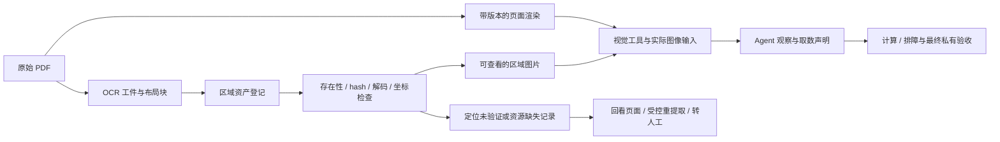

# 多模态 Agent：页面与 OCR 视觉区域

状态：2026-10-19 已确认的设计范围，拟作为 V0.2 扩展。用户同意加入图像，并明确包括 OCR 检测到的图片。本文定义接入方式；当前 V0.1 的 5 个 schema、15 个工具和 4 个合成案例仍为文本/结构化协议，尚未升级为以下媒体契约。环境、视觉工具和多模态训练均待实现。

共用 OCR 资产、视觉能力 SFT、Agent SFT 与在线 RL 的分工和实施路线见 [SFT 与 Agent RL 联合设计](sft-and-rl.md)。

## 1. 范围与资产入口

在 `research` 和 `operations` 两条任务线共用文本、结构化表格及静态图像。图像入口包括：

| 入口 | 用途 | 必须保留的关系 |
| --- | --- | --- |
| 原始 PDF 的页面渲染 | 查看完整表头、单位、附注和相邻上下文 | 文档版本、PDF hash、页码、渲染版本及页面坐标系 |
| OCR 返回的区域图片 | 查看 OCR 检测到的 image/chart/table/figure 区域 | OCR 工件/版本、block 身份、区域原文件与派生图片 hash |
| 已验证 bbox 从页面裁出的区域 | 根据需要查看或放大局部 | 父图、bbox、坐标变换、裁剪版本及输出 hash |
| 表格结构/OCR 文字 | 与图片对照、计算、诊断抽取错误 | 对应图片与 OCR 工件、结构版本；记录其为待核对的模型输出 |

OCR 的图像区域同时包含统计图、表格、流程图、插图等。检测标签是线索，不保证类型或内容正确。原有 `asset_kind=image/table` 与 `ocr_label` 分开保留；适配器可增加规范内容类型，不把原始标签覆盖为推断真值。装饰图、logo 和无关图片也保留资产记录，按任务相关性筛选。

现有 `processing/visual_assets.py` 能登记视觉 occurrence、可用的 OCR 返回区域、受条件限制的 PDF bbox 裁剪及失败记录；`visual_asset` / `visual_description` 和 v7 证据包可复用。`visual_description` 是派生模型描述，不能替代向视觉策略传递图像，也不能直接当作答案或视觉真值。

本期接入页面与静态区域图片。音频、视频作为后续候选，暂无相应任务或契约。

## 2. 接入流程与定位质量

1. 保留 OCR 原始 block、图片引用和版本。仅从已登记、本地范围内的资源解析图片，不按任意 URL 下载附件。
2. 优先使用可精确关联到 block 且 hash 校验通过的 OCR 区域文件。原始文件与必要的 PNG 规范化输出分别记录 hash、转换参数及血缘；格式转换后的文件不宣称与原始编码字节相同。
3. OCR 返回的区域可以具有可读图像而没有可验证的原页 bbox。此时 `pixel_status=available`、`localization_status=unverified` 可以同时成立：允许查看并引用该资产，禁止伪造原页坐标。页码及 block 来源也须有确切关联。
4. 只有验证原页坐标、旋转/展平变换、尺寸与边界后，才允许从原 PDF 按 OCR bbox 裁剪。沿用现有提取器对未验证旋转/展平映射的拒绝逻辑。
5. 只有 bbox 而无可用区域、且变换无法验证时，记录 unresolved；可回看可用的整页、在已查看的页面上重新选择裁剪区域，或按任务要求转交。不能按猜测坐标生成可信证据。
6. 表头、单位、图例或附注不全时，允许继续查看父页面或申请包含上下文的裁剪。保留原区域，新裁剪作为派生资产；不能默默截断再声称材料充分。

## 3. 拟增加的工具

以下是新增接口设计，尚未加入 V0.1 `tools.json`。只在任务允许范围内启用，各工具输入与逐工具输出 schema 随 V0.2 一并版本化。

| 工具 | 输入概要 | 返回/作用 |
| --- | --- | --- |
| `list_visual_assets` | document_id、page?、cursor? | 区域 ID、检测标签、可用性与定位状态；列表本身不算看过图像 |
| `open_page` | document_id、page | 页面图片与来源、渲染和坐标 metadata |
| `read_visual_asset` | visual_asset_id | 实际图片、原始来源、坐标系与质量状态 |
| `crop_region` | 已观察 image_id、bbox_px | 父图坐标中的受控裁剪，新图片 ID、变换与 hash；拒绝越界坐标 |
| `read_ocr_result` | visual_asset_id / block_id | 已登记 OCR 文字或结构及其版本，明确为可出错的提取结果 |
| `register_visual_observation` | image_id、region、字段/期间/口径/单位/数值声明 | 记录 Agent 的取数与证据声明，返回 observation_ref；仅校验协议和引用，不透露正确性 |
| `reextract_visual` | visual_asset_id、processor_profile_id、request_key、expected_state_version | 通过有界 stage adapter 创建新提取任务/派生版本；旧工件与审核不变，执行后独立复验 |

`crop_region` 是可重放的媒体派生操作，不修改源文件、原始 OCR 或已发布工件。它计入动作与图像预算，需在 episode 内记录确定性参数和派生文件，不能通过重复裁剪获得额外奖励。裁剪几何固定，并保留可恢复到父图的变换；模型输入缩放另记预处理参数，不隐式混入原始 bbox。

财报取数通过 `register_visual_observation` 生成可计算引用，扩展 `calculate` 接受这些声明引用及其单位。注册成功不等于取数正确，计算器只验证运算协议、单位和算术；最终验证器独立校验原图支持、数值及业务口径。这样可以从图片读数后计算，且不把宿主 oracle 中的正确单元格提前返给 Agent。

区域证据使用实际观察的 image_id、该图像坐标内的 bbox 和源链。只有变换可验证时，才附加原页面坐标。黄金证据框由 oracle 私有保存；输入区域来自真实 OCR 检测或 Agent 选择，不按黄金答案偷偷裁剪。

## 4. 媒体与轨迹契约

V0.2 需要联动升级 task、fixture、trajectory、oracle、工具注册与导出适配，而非只给 JSON 多放一个图片路径。

| 对象 | 拟新增内容 |
| --- | --- |
| Task | input_modalities、允许视觉工具、单次/累计图片及像素预算、任务所需精度与可接受弃答条件 |
| Media manifest | image_id、相对文件路径、MIME、hash、尺寸/字节、source document/work/version、page/block、父资产与变换 |
| 定位状态 | pixel_status 与 localization_status 分开；bbox 所属坐标系、父图尺寸、变换版本及是否已验证 |
| Observation | 有顺序的 text/image 内容块、媒体引用、错误码、截断/分页与预算消耗；图片须实际加载交给模型 |
| 视觉取数声明 | 原始读数字符串、解析后的 Decimal 字符串、实体/期间/口径/单位与倍率、图像区域、statement_ref |
| Trajectory binding | 视觉模型、processor/chat template、图像解码/缩放/切片策略及版本、实际输入媒体身份和顺序 |
| Oracle | 可接受的视觉证据区域/集合、独立数值真值、精度/容差、可读性与处置条件 |

媒体路径只由宿主 manifest 解析，不向模型开放任意文件读取。重放校验媒体字节及变换参数，核对模型实际收到的图片；失去媒体文件或原生训练捕获的文本日志不能冒充多模态训练轨迹。

在线 RL 除 assistant tokens、行为策略 logprobs 和 loss mask 外，还要绑定实际视觉输入与 processor 产物/重建参数。是否保存处理后的张量或由不可变图像和锁定版本重建，在训练适配时明确；不能忽略随机预处理或只重建文本。视觉观察继续作为上下文，策略损失作用于模型生成的动作与回答。

## 5. 两条任务线

### 5.1 财报视觉取证

首批从清晰的表格区域开始，再增加带明确标签的统计图。

- OCR 检测到表格区域 → 查看图片 → 回看整页核对单位/口径 → 登记取数 → Decimal 计算 → 提交图像证据。
- 图表读取：核对图例、期间、坐标轴、单位和数据标签，再做对比或计算。
- 跨模态核对：发现 OCR 与图片不一致，依据可读原始材料提交正确数值或材料不足结论。

划分 `vision_only` 与 `vision_with_ocr` 任务条件：前者只提供图片和必要来源身份，关闭 OCR 文字、模型描述和对应正确表格的捷径；后者允许查看 OCR，但标明其为提取结果。来源相同、条件不同的任务分组一致，评测分别报告。

精确金融计算须有可读数字和独立核对的参考值。仅凭柱高/曲线估计的题目单独声明近似任务、容差与可接受证据；模糊图片不能强行生成精确答案。增加真实不可辨认材料的正确弃答评测，同时报告误弃答。

### 5.2 视觉治理与排障

| 情况 | 预期处置 | 验收重点 |
| --- | --- | --- |
| OCR 漏负号、小数点或表格错列 | 对照原图诊断；通过有界处理器重新提取，或转人工 | 原始证据不变，重新生成的结构和值独立核对 |
| 裁剪缺表头/单位/图例 | 查看父页面或生成带上下文的新裁剪 | 补充图像确有必要上下文，引用与变换可追溯 |
| 区域文件缺失/损坏、有可信副本 | 可信恢复并复验 | 真实字节与原登记 hash 匹配 |
| bbox 越界、坐标变换不可验证 | 查看可用整页、重新定位或转交 | 不伪造原页坐标，不误把未验证定位发布为可信 |
| 模糊或不相关区域 | 正确判定不适用/不可读，按任务转交或无需操作 | 不捏造数值、不把装饰图强行制成训练问答 |

恢复旧文件与重新 OCR 是不同操作：恢复沿用可信旧 hash；重新 OCR 产生新派生版本和新 hash，保留旧工件、旧人工决定和差异。新输出仍走正常审核，不能套用旧批准或修改期望 hash 来掩盖错误。不能用 Agent 提交的读数直接充当修复正确的证明。

## 6. 独立验收、划分与奖励

主奖励继续沿用任务完成 1、有效失败 0、越权/保护集合破坏 -1；读取图片、重复裁剪或生成更长描述均不自动加分。

- 数值金标来自独立核对的原始材料或人工审核的合成生成参数，不从同一份待诊断 OCR 直接复制。取数声明与 judge 分数不能自证正确。
- 验收图像确实被模型观察、来源/版本与实体/期间/口径正确、引用区域支持答案。支持多组等价区域，不要求与一个黄金框逐像素相同；坐标正确也不等于语义支持。
- 排障直接检查最终文件和数据库、派生版本、保护集合及复验记录。可修复案例直接转人工仍不通过。
- 同一 PDF/逻辑作品的整页、OCR 区域、重编码、缩放、OCR 版本和故障变体作为同源组划分，避免原页在训练、裁剪图在测试。
- 预置裁剪/识别故障属于有效任务；意外宿主媒体损坏或推理服务失联属于基础设施异常，记录原因并排除训练。
- 分别报告纯文本、vision_only、vision_with_ocr；比较时记录各条件可见信息，分别评估工具 SFT 与多模态 RL 的增益。

## 7. 实施顺序

1. **V0.2 契约**：同步升级上述媒体/任务/轨迹/工具/验收字段与版本，保留 V0.1 案例的原绑定；新增案例不伪装为已执行数据。
2. **视觉环境**：用离线固定图片跑通页面、区域、裁剪及真实图像观察；检查 hash、坐标、顺序、图像预算与动作重放。
3. **案例**：先做 OCR 表格区域取数、漏负号诊断、缺表头回看页面、定位未验证转交四类；每类加正常对照和拒绝案例。需要真实或人工核对的图像文件，当前尚未生成这些视觉 fixture。
4. **基线与 SFT**：复用现有治理资产和视觉SFT，接入支持图像和工具交互的模型；按实际后端错误和 bad case 迭代，不重复校准上游数据。
5. **多模态 RL**：锁定视觉模型/processor/训练栈与原生捕获，profiling 后确定预算和批量，再做参数更新与保留集比较。

现有 research 8 次调用和纯文本上下文建议不直接套用于视觉任务。按参考路径单独设置动作、图片数、总像素/视觉 tokens 和延迟预算，避免因为新增查看与取数步骤导致任务天然不可完成。核心环境继续与 GPU 训练依赖分离。
