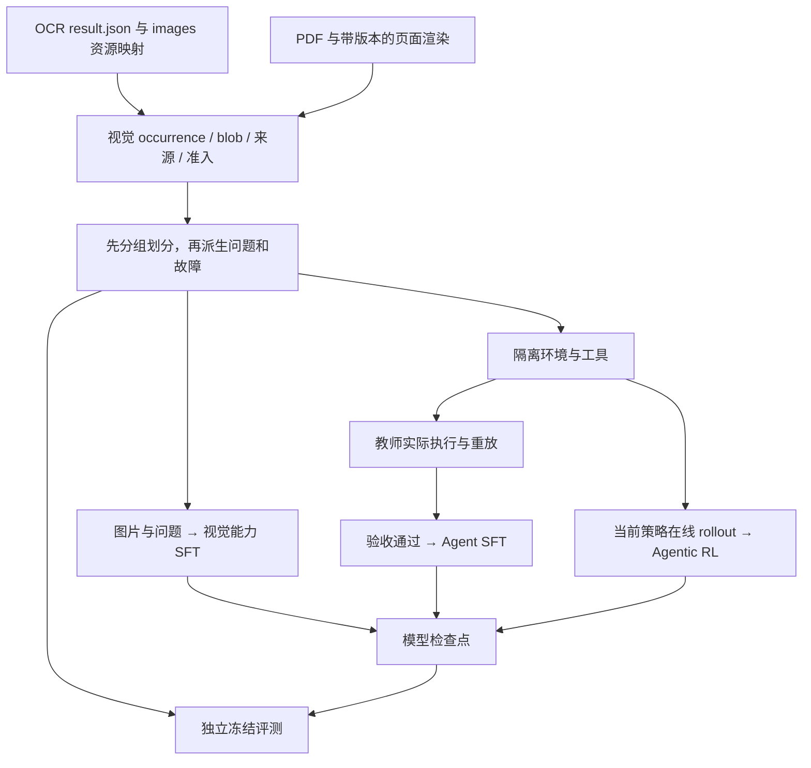

# OCR 图像资产、视觉 SFT 与 Agentic RL 的联合设计

本设计说明 OCR 资产如何用于视觉 SFT、Agent 工具示范和在线 RL。结构化表格研究任务的准备、SFT、GRPO 与冻结评测命令见[RL 运行指南](trainers/rl/README.md)。

已实现[治理资产导入](assets.md)，Agent 与视觉 SFT 共用 `EvidenceLoader`，继承既有候选审核、图片关联与血缘。资产导入沿用已有治理结果。[OCR 图片摸底](inventory.md) 是旧产物的可选诊断，用于检查历史文件映射。

## 1. 总体方案

使用同一套可追溯图像资产，产出三个独立版本的数据产品：

| 数据产品 | 学习目标 | 一条数据是什么 | 质量验收 |
| --- | --- | --- | --- |
| 视觉能力 SFT | 看清内容、取数、识别单位和口径、理解表格 | 图片与问题 → 答案/结构/证据 | 模型输入中确有支持答案的可读图片 |
| Agent SFT | 选择工具、补充材料、计算、恢复、转交 | 一个完整 episode 的调用、图像观察与最终提交 | 实际执行、重放和私有验证通过的示范 |
| Agentic RL | 根据状态和反馈改善行动策略 | task + 初始环境 + 媒体 + 私有 oracle | 当前行为策略在线交互，按独立结果验证给奖励 |

视觉 SFT 建立阅读能力，Agent SFT 建立工具使用习惯，RL 再优化查阅、核对与处置策略。三者可以复用训练 split 的来源资产；评测来源与它们保持隔离。



## 2. 核对过的 OCR 图片保存方式

当前 Serving 客户端与 Cloud 客户端均会将返回图片落地到 OCR 输出目录的 `images/`。当前版本的主要布局如下，旧输出可能不同：

```text
<ocr-output>/
  result.json
  output.md
  images/
    input/page_0001.jpg                 # 返回的 inputImage，若提供
    markdown/page_0001/<source-name>     # 页限定的区域资源
    output/<backend-specific-name>      # 页面输出或调试图片
```

已核对代码：[Serving 图片落地及映射](../remote/paddle_client.py)、[Cloud 图片落地及映射](../remote/paddle_cloud_client.py)、[视觉资产提取](../processing/visual_assets.py)。

- `result.json` 的 `image_assets` 保留 `source_key/path/page/purpose/sha256`。区域 `purpose=region`；返回输入页标为 `original_page`；其余可能是 `page_or_debug`。
- Serving 的 markdown 区域按页保存。Cloud 同时保留旧别名和页限定副本；应以映射中的页限定路径为准，不能用可能重复的原文件名做全局身份。
- OCR 不一定返回每个 table 的独立 PNG；有的表格只有布局块、文字或 HTML。`image/chart/table/figure` 检测块通过资产状态记录区域文件的可用性。
- `images/` 中的存在性只能说明有文件。整页、正文区域、模型可视化和调试图需要按映射与内容分类；调试叠框图不默认充当原始财务证据。
- `inputImage` 的用途标签保留来源用途信息。原页定位仍须核对尺寸、旋转、展平和变换；需要确定原页时可使用带版本的 PDF 渲染。

因此接入顺序为：**读取 OCR 映射 → 精确关联页面与 block → 校验本地文件和 hash → 解码/尺寸检查 → 登记视觉资产**。不采用全目录 glob 后直接生成问答的方式。

当前提取器已将成功图片规范化为 PNG，并写入 `<data-root>/media/blobs/<sha256>.png`，用 `visual_asset` 分别记录每次 occurrence。这个机制继续复用。

## 3. 共用资产层

### 3.1 三种身份分别保留

| 身份 | 代表什么 | 为什么需要 |
| --- | --- | --- |
| Blob | 一份具体编码的图像字节，以 sha256 寻址 | 去重、完整性校验、便携打包 |
| Occurrence | 某报告/版本/页/block 上出现的图像 | 相同图片可以有不同来源、实体与上下文 |
| Derivation | 从父图或 PDF 得到的新图及操作参数 | 追溯裁剪、格式转换、缩放和页面渲染 |

相同 blob 保留各次 occurrence，原文件与规范化 PNG 分别登记 hash。

拟升级的媒体 manifest 至少记录：原文件与规范化文件的各自 hash/MIME/尺寸、文档/work/version、OCR 工件与后端/版本、page/block/source_key、原始 `ocr_label`、用途、父资产、坐标系/变换，以及来源准入和质量决定的引用。

图片可用性与定位可信度分别记录。可读区域即使没有原页可信 bbox，也可以用于仅凭区域内容即可回答的任务；不得附造出的原页坐标。没有可信变换时，Agent 可以在已查看页面的坐标系中选择新区域。

### 3.2 按任务判断可用性

| 资产情况 | 视觉能力 SFT | Agent SFT / RL |
| --- | --- | --- |
| 清晰且包含必要表头/单位/正文 | 适合直接看图问答与抽取 | 适合分析与核对 |
| 图片可读，但裁剪缺单位或表头 | 当前单图直接问答不准入；多图配方需把必要父页一并提供 | 适合“回看父页/重裁剪”任务 |
| 真正模糊、材料不足 | 现有生成器跳过；新增受控弃答任务需独立金标 | 适合核实后弃答或转交，另报误弃答率 |
| 文件缺失/损坏 | 不作为可加载图片进入直接 SFT | 可作为预置恢复故障；恢复后才产生真实图像观察 |
| logo/装饰图/调试图 | 通常不生成金融问答，记录筛除原因 | 可用于相关性过滤/无需处理对照；不能捏造金融任务 |

同一资产在不同任务中的可用性可以不同。来源训练准入、资产质量、任务可回答性是分别校验的门槛。

资产适配器沿用已批准 visual candidate 的准入、审核、图片关联与血缘。

### 3.3 快照与数据划分

上游资产库统一保留；Agent 的不可变快照/发布包复制必要媒体或按版本清单导入，使用包内相对路径。执行环境不直接写上游 `images/` 或共享 blob，不使用可写 hardlink。

在生成任何问答/轨迹之前，对逻辑作品、报告版本、同源整页/区域、相关重复内容、OCR 版本与故障族建立统一分组。视觉 SFT、Agent SFT、RL 与最终评测共同使用分组账本，并承接已有 CPT/SFT 的来源使用记录。

同一图像的裁剪、缩放、重编码或 OCR 修订不能跨 train/test。复用的通用 logo 等无关图先从任务候选中筛除，避免将无关重复误作金融任务证据。开发集与冻结评测分开；无法独立隔离的任务显式标注 source_seen。

## 4. 视觉能力 SFT

### 4.1 现有能力与扩展

现有 [training/sft_vision.py](../training/sft_vision.py) 支持 `visual_qa`、`table_structure`、`visual_description`、`visual_conversation`。默认 [sft-vision 配方](../config/sft-vision.json) 只启用前两项。

导出格式：每条样本一张 PNG；同图对话共享首轮图片；表格抽取只接受简单完整矩形表；数值保留原字符串；证据区域采用当前图的 0–1000 归一化整数坐标。复杂表头不能被强行压平成损失信息的矩形 JSON。

Agent 裁剪采用当前 image_id 的像素坐标。两类数据交换时显式转换坐标并记录版本：对宽 W、高 H 的图片，以 x·W/1000、y·H/1000 换算，左/上向下取整、右/下向上取整，使用半开矩形并验证边界。不同裁剪图的 bbox 不能直接复制，须沿已验证的父子变换映射；模型输入缩放后的坐标另记。

| 任务 | 输入与输出 | 设计状态 |
| --- | --- | --- |
| 看图问答、简单表格抽取、图像描述、同图对话 | 图片 → 可见事实/结构 | 使用现有生成与审核配方 |
| 视觉定位 | 图片＋问题 → 值及支持区域 | 新配方；证据框作为监督输出，不能提前放进输入 |
| 视觉计算 | 一张/多张图片＋问题 → 数值、单位及证据 | 新配方；视觉取数人工/独立核对，程序验证计算 |
| 图像与 OCR 核对 | 图片＋有版本的可错 OCR → 不一致项/有依据的修订建议 | 新配方；明确属于 vision_with_ocr |
| 材料不足判定 | 无法回答的图片材料 → 有依据的弃答 | 新配方；控制误弃答，区分可补材料与确实不足 |

新的多图、计算、定位、弃答任务不能仅在现有配置里增加 task 名；需要任务注册、生成/审核、消息/媒体绑定与 exporter 联动升级。

### 4.2 输入可见性与监督

- `vision_only`：学生实际收到图片与问题及必要来源身份，不收到对应 OCR 数字、模型描述或正确表格。教师可以用 OCR 辅助构题，但答案必须由学生收到的图片支持。
- `vision_with_ocr`：学生实际收到图片与显式标注为可错的 OCR；用来训练核对和纠错。不可与 vision_only 混报成绩。
- 多图任务确保学生与审核器看到相同的图像集合/顺序及允许上下文；教师额外使用的构题辅助材料单独记录。若单位只在父页上，父页必须进入学生输入。
- 保留原始读数字符串及规范化 Decimal、单位和倍率，不能直接移除负号或模糊替换括号。
- 训练目标包含回答/结构或显式要求的证据输出；金标、审核理由、来源分组及教师辅助材料不作为学生输入。工具结果不属于这类直接问答的监督目标。

### 4.3 生成、审核与发布

治理资产 → 按既有 split 选择任务 → 教师生成与规则检查 → 视觉审核 → 去重发布。

规则校验 hash、格式、区域边界、表格完整性和程序算术；视觉审核检查图片实际支持、数值符号、实体/期间/口径、单位、所有轮次。参考数值绑定独立核对的原图与来源。

视觉导出复用 vision JSONL、`images/<sha256>.png` 与 `images.jsonl`。多图扩展通过内容块的 image_id 记录图片顺序与派生关系。

## 5. Agent SFT：实际工具示范

Agent SFT 的单位是完整可重放 episode，包含：task、工具表、逐步 assistant 动作、tool 观察中的实际媒体、最终提交、私有验收结果与媒体/代码版本。

教师在隔离环境中执行工具，示范经动作重放、来源/媒体校验与最终 verifier 筛选。

两条典型路径：

1. **财报分析**：检索 → 列出视觉资产 → 查看 OCR 区域 → 必要时回看父页 → 登记图中取数声明 → Decimal 计算 → 提交引用。
2. **视觉排障**：查看任务与血缘 → 加载原图和 OCR → 发现差异 → 选择允许的重新提取/可信恢复/转交 → 复验 → 提交结果。

示范选择遵循：完成 case 要求且无越权；可修复任务不能靠转交通过；预置业务故障可以被正确处理并成为正例。教师自己的无效调用不作为正例动作监督，可保留必要上下文并 mask 对应 assistant 输出。

Agent SFT 监督 assistant 工具调用与最终提交，图像、用户问题和 tool 观察作为上下文，不进入目标 loss。

现有 [sft_export.validate_messages](../training/sft_export.py) 要求 system 后按 user/assistant 交替，不支持 tool 角色。新增 Agent exporter/loader 承载类型化工具调用与多模态观察，再按已选训练框架序列化；保留原有直接 SFT 协议。

## 6. Agentic RL：任务环境与在线采样

### 6.1 训练输入与轨迹

RL 发布的是任务、隔离初态、允许媒体与工具、版本和私有 oracle。在线轨迹由当前行为策略产生，教师示范用于 SFT。

环境的真实图像观察、裁剪参数与预处理版本必须绑定到训练后端。保存 assistant token IDs、行为策略 logprobs、loss mask 及实际图像输入/processor 产物或可确定重建参数。多轮工具返回使用有序的 text/image 内容块。

保留有效失败与组内相对奖励所需轨迹，不按成功比例手工拼接当前策略样本。基础设施异常单列，不让随机媒体丢失污染策略失败标签。

### 6.2 两类任务与奖励

| 任务线 | 首批场景 | 独立验收 |
| --- | --- | --- |
| 财报视觉取证 | OCR 区域取数、父页补单位、跨期计算、图文冲突、真正材料不足 | 答案及单位/口径、可支持的已观察证据、正确弃答 |
| 视觉治理排障 | 漏负号/小数点、表格错列、区域缺表头、图片缺失、坐标变换不可信、正常对照 | 实际文件/派生版本、任务和审核状态、保护集合及复验 |

沿用完成任务 `1`、有效失败 `0`、越权或破坏保护集合 `-1`。图片查看次数、裁剪次数、描述长度不直接加分；judge 初期只辅助审计。若全零组过多，先检查任务可解性、暖启动与难度课程，再决定经过验证的中间奖励。

视觉取数声明交给独立验证器核对来源、数值与口径。文件恢复使用原登记 hash；重新 OCR 创建新版本、新 hash 和新的审核记录。

### 6.3 有界重新提取

拟增加 `reextract_visual(visual_asset_id, processor_profile_id, request_key, expected_state_version)`，通过有界 stage adapter 执行。输入仅允许宿主登记的处理器配方 ID；不能传任意命令、路径、提示词或配置。

它创建派生版本及任务，返回排队/处理状态；最终仍须读取新工件、独立核对和复验。同 key 幂等、范围/预算/状态版本与保护集合约束沿用现有设计。OCR/模型处理器通过独立配置接入 stage adapter。

## 7. 一个贯通 SFT 与 RL 的案例

假设人工核对的原表显示某年度现金流为 `-120`，待诊断 OCR 丢失负号写成 `120`。

| 阶段 | 给模型什么 | 期望输出/行为 |
| --- | --- | --- |
| 视觉能力 SFT | 清晰表图＋询问该指标的问题 | 读出 `-120`、可见单位/期间及支持区域 |
| 图文核对 SFT | 同图＋标为待核对的 OCR `120` | 指出符号差异，给出有证据的修订建议 |
| Agent SFT | 状态异常的问题、工具、可查询的图像/OCR | 教师实际查看、诊断、受控处理、复验后提交 |
| Agentic RL | 同类任务的训练 split 变体和隔离环境 | 当前策略自行选择查阅/处理路径，按实际结果得分 |
| 冻结评测 | 未用于上述训练/校准的作品和场景族 | 检查新来源及新故障上的恢复与误修率 |

同一来源可以在训练 split 内贡献这几类数据；不能再把它的换字问题、其他裁剪或 OCR 版本作为独立最终测试。该例使用合成数值说明数据流。

## 8. 运行入口

[治理资产导入](assets.md) · [单卡 SFT](trainers/sft/README.md) · [Agent SFT 与 GRPO](trainers/rl/README.md)
