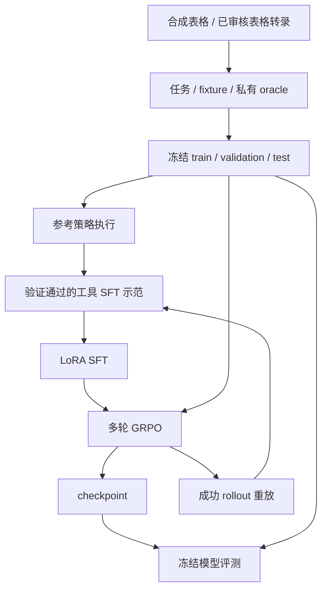
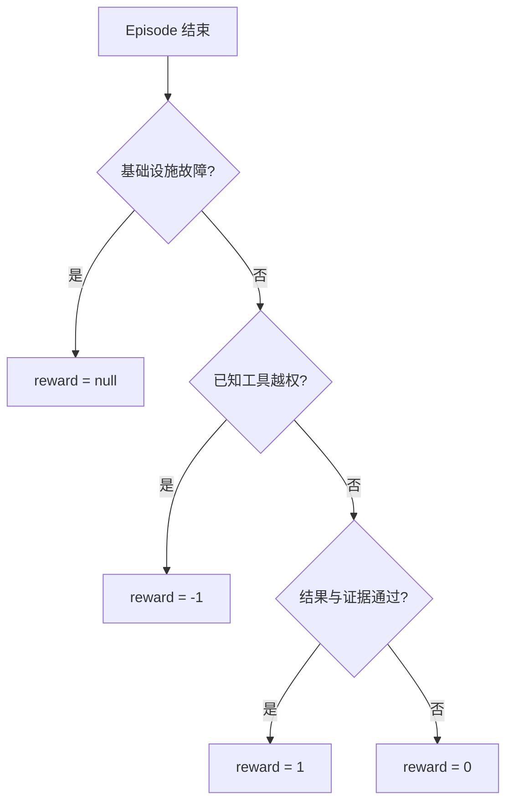

# Agentic RL 架构

研究任务将财报表格转换为工具交互环境，连接参考示范、Agent SFT、多轮 GRPO 和冻结评测。安装与运行命令见[RL 指南](https://github.com/Chal1ce/FinFlow/blob/main/agent/trainers/rl/README.md)。

## 训练链路

`rl-build` 生成合成计算任务，`rl-import` 读取已接受的 `table_structure` 样本。导入器复用原表格的 work、content、image 划分及来源记录，生成可检索的结构化数值行。`rl-start` 保存实验输入、配方与阶段状态，并衔接 SFT 和 GRPO。

## Episode 与工具

环境在冻结 case 上创建独立 episode。模型每轮生成一个 JSON 工具调用，环境执行后返回 observation，直到提交答案或达到动作/生成预算。

| 工具 | 作用 |
| --- | --- |
| `search_documents` | 按公司、期间、查询检索表格并分页 |
| `read_table` | 返回已检索表格的行列、单位、口径和 cell ID |
| `calculate` | 使用已观察的 cell/calculation 引用执行 Decimal 运算 |
| `submit_answer` | 提交数值结果和证据 |

解析器支持 JSON fence 和字段别名，并记录格式修复。未知工具名返回 `unknown_tool`，模型可继续纠正；已知但未授权的工具终止任务，记录 `forbidden_action`。

## 奖励

私有 oracle 保存参考计算和等价证据集合。终局验证器核对公司、口径、期间、单位、数值、小数位和支持证据。

数值错误、小数位错误、期间错误及证据缺失分别返回原因代码。训练默认允许完整支持集合之外的额外已观察证据；冻结评测默认检查精确支持集合，同时记录 `strict_support`。

## ms-swift 对接

插件使用固定版本 ms-swift 的多轮 hook：

1. `on_trajectory_start` 装载 case，将任务与工具协议写入首轮消息。
2. `on_turn_end` 解析 assistant 调用并推进 episode。
3. `step` 返回工具观察，进入下一轮生成。
4. 终局奖励通过 `rollout_infos.total_reward` 交给训练器。

训练后端捕获 token IDs、行为策略 logprobs 和 assistant loss mask。工具观察作为上下文，mask 只监督 assistant 输出。配方启用 `dynamic_sample`，对组内奖励零方差的任务重采样。

默认每题 4 条轨迹，每个优化步覆盖 4 道题；`generation_batch_size=16`，`gradient_accumulation_steps=16`。模型、依赖版本与完整参数位于 [RL 配方](https://github.com/Chal1ce/FinFlow/blob/main/agent/trainers/rl/qwen3.5-0.8b.json)。

## 冻结、恢复与评测

运行开始时将任务、fixture、oracle、工具表及文件 hash 冻结到 `finflow-inputs/`。checkpoint 恢复沿用对应输入与 adapter 绑定；流水线以请求步数的最终 checkpoint 作为阶段完成条件。

| 入口 | 输出 |
| --- | --- |
| `rl-report` | 按 attempt、split、phase、难度和任务族统计奖励与错误；按优化步和 case 聚合组级诊断 |
| `rl-eval` | 固定 split 上运行 reference、replay 或 model 策略，输出 pass@1、pass@k、置信区间与失败原因 |
| `rl-sft --from-episodes` | 从训练 split 的成功在线轨迹重放、筛选并导出 SFT |

代码入口：[研究环境](https://github.com/Chal1ce/FinFlow/blob/main/agent/environment/research.py)、[验证器](https://github.com/Chal1ce/FinFlow/blob/main/agent/verifiers/research.py)、[多轮插件](https://github.com/Chal1ce/FinFlow/blob/main/agent/trainers/rl/swift_plugin.py)、[实验编排](https://github.com/Chal1ce/FinFlow/blob/main/agent/pipeline.py)、[评测](https://github.com/Chal1ce/FinFlow/blob/main/agent/evaluation)。

框架接口参考：[Gym 环境](https://github.com/modelscope/ms-swift/blob/2efb43ffe61294735be6816abca991fb2ca16011/docs/source/Instruction/GRPO/DeveloperGuide/gym_env.md)、[多轮执行器](https://github.com/modelscope/ms-swift/blob/2efb43ffe61294735be6816abca991fb2ca16011/swift/rollout/agent_loop.py)、[loss mask](https://github.com/modelscope/ms-swift/blob/2efb43ffe61294735be6816abca991fb2ca16011/swift/loss_scale/base.py)。
