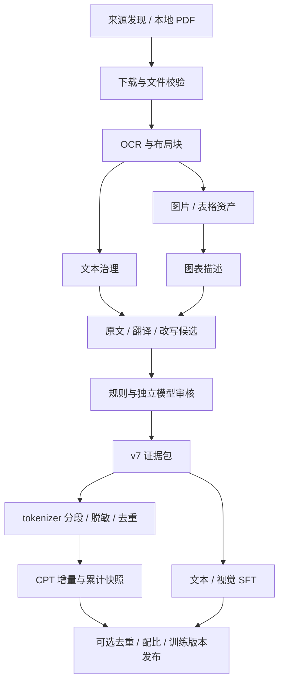

# 数据飞轮架构

每日飞轮将来源发现、OCR、文本与图表治理、候选审核及训练数据导出连接到持久任务队列。配置和命令见[每日数据飞轮](data-flywheel.md)。

## 处理链路

## 编排与状态

| 层 | 职责 | 主要模块 |
| --- | --- | --- |
| 发现 | 来源查询、分页进度、下载记录 | `spiders/` |
| OCR | 本地/云端调用、布局与图片落盘 | `remote/` |
| 治理 | 文本清洗、分块、元数据、表格摘要 | `processing/` |
| 任务与血缘 | 队列、依赖、租约、工件、候选决定 | `storage/` |
| 证据发布 | 文本、视觉资产与工件依赖闭包 | `delivery/` |
| 训练数据 | CPT/SFT、划分、配比与版本 | `training/` |
| 编排 | 预检、阶段执行、续跑与日报 | `workflow/` |

发现记录落盘后推进来源 cursor，下载与模型处理由队列接管。任务以输入、处理配方和模型身份生成幂等键；续跑复用成功结果，并恢复延期或可重试任务。

`processing_task` 保存依赖、状态、重试时间和租约。运行使用整轮锁，任务在领取后执行；执行结果和工件文件分别通过事务与原子写入持久化。

## 视觉资产

图像文件按内容 hash 保存，`visual_asset` 记录它在具体文档、页码和 OCR block 中的来源。相同字节可以共用文件，各次来源 occurrence 单独保留。

| 记录 | 内容 |
| --- | --- |
| 视觉资产 | 类型、原始 OCR 标签、来源文档、页码、bbox、图片 hash、尺寸与状态 |
| 视觉描述 | 输入图片与上下文、模型/提示词版本、响应与解析结果 |
| 工件关系 | PDF → OCR → 区域图片 → 描述 → 候选 → 样本 |

优先使用 OCR 返回的区域图；使用 PDF 裁剪时，按页面尺寸和坐标变换定位。正文清理与视觉资产登记分别保存，表格 HTML、Markdown、原图和描述通过血缘关联。

## 候选与训练数据

候选按 `accepted`、`rejected`、`needs_review`、`pending` 保存独立决定。`source_policy` 控制来源训练准入，OCR 质量、规则检查和模型审核控制候选处理。文本、视觉描述、翻译与改写分别审核。

v7 证据包包含候选、决定、图表清单和依赖文件。CPT 以目标 tokenizer 分段，按正文去重并保存全部来源；同一逻辑作品的原文和派生内容共用 split。SFT 从已批准证据构建文本问答、抽取、计算和视觉任务。

CPT 按新增内容发布增量，单独记录新增血缘；累计快照汇总选定增量。SFT 按所选证据和配方导出累计快照。发布格式见[训练数据](training-data.md)和[训练版本发布](training-publication.md)。

## 配置与运行

- `.env`：服务连接、模型角色、tokenizer 和运行参数。
- `config/collection.json`：采集来源、公司、年度与论文查询。
- `config/flywheel.json`：生成方法、来源准入、任务预算和可选阶段。
- `data_root`：原始文件、处理产物、SQLite、证据包与训练数据。

调度模板调用同一个 CLI，手工运行与定时运行共享队列和恢复机制。状态、进度和日报用于本地运行排查，命令见[日常操作](data-flywheel.md#3-日常操作)。
